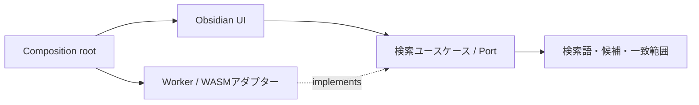

# SoftMatcha Search の設計

## 境界と用語

検索コンテキストは検索語、候補、類似度、一致範囲を扱う。候補の識別はノート相対パスと行番号。一致範囲は表示する抜粋内のUTF-16オフセットであり、モデルが置換した実際の原文に付ける。

索引コンテキストは文書、トークン、シャード、索引世代を扱う。文書の識別は相対パス。シャードは安定したパスハッシュで分割する。文書内容とモデル・辞書の版から再利用可能な索引を識別し、完成した世代を公開する。モデルは検索窓ではなくエンジンの寿命に属する。

DDDの境界と不変条件をコードへ置き、Clean Architectureで実行環境への依存を外側へ向ける。小さな検索システムなので、各型へRepositoryやServiceを一律に追加しない。

## 依存方向

`src/main.ts` はObsidianのライフサイクルだけを接続する。`src/composition/` が具象アダプターを選ぶ。`src/presentation/` は検索窓、設定画面、ノートを開く操作、描画。WASMを直接参照しない。

`src/domain/search.ts` は検索値、検索語検証、一致範囲の検証・マージ。Obsidian、HTTP、タイマー、Workerに依存しない。

`src/application/` は `SearchEngine` と `Scheduler` のPortを宣言し、`SearchSession` が起動時準備、再試行、検索の直列化、古い入力の破棄、終了時処理を担当する。画面を閉じてもエンジンを破棄しない。失敗した検索が後続のキューを止めない。

`src/infrastructure/` はHTTP、Obsidianの読み取りAPI、Worker RPC、辞書ロード、IndexedDBの実装。ノートへの書き込みは行わない。リンク挿入だけはユーザーがAlt+Enterした際の既存UI操作として残す。

## Rustの境界

- `rust/core/src/domain.rs`: 文書・トークン・候補と単語ベクトルの検証。
- `rust/core/src/application.rs`: 検索実行と `IndexRepository` Port。索引の具象実装をimportしない。
- `rust/core/src/indexing.rs`: メモリ上の圧縮接尾辞索引、文書境界、候補位置の復元、UTF-16範囲への変換、索引保存・復元。
- `rust/core/src/upstream/`: 固定した公式SoftMatcha 2の候補列挙・検索コードの移植。Python/NumPy、Unixのpread、Rayonを外し、バイト列・ndarray・逐次処理・web-timeへ置き換えた。
- `rust/wasm/`: wasm-bindgenによる外側の入出力アダプター。OS固有コードを持たない。

WASM版は自前でポータブル索引を構築し、pair/trioビット集合の追加枝刈りを省略する。単語の置換・挿入・削除を列挙する本体アルゴリズムは保持するが、候補数・時間上限、日本語の辞書実装、索引の構築法が異なるため、ネイティブ版と全クエリで完全に同じ順位になる保証はしない。

## 起動・検索・更新

1. Obsidianのレイアウト準備完了時に非同期で準備を始める。
2. ローカルWASMでは公開モデル・IPADIC辞書を読み、一つのWorker内に常駐させる。初期化中の要求は同じPromiseを待つ。
3. ノートの一覧・版を調べ、内容をWorkerへ渡す。モデル版・辞書版・文書内容から索引キーを計算する。
4. IndexedDBのチェックポイントがあればハッシュを検証して復元し、なければ変更したシャードを構築する。新しい世代が揃うまで古い索引を残す。失敗した新世代は取り除く。
5. 入力を80ms待機し、IME変換中は検索しない。待機中に古くなった検索はエンジンに送らない。
6. 辞書で分割した検索語をIDに変換し、語彙との類似度を計算、公式アルゴリズムで候補列挙、文書・行へ戻して上位候補を表示する。
7. 一致した実際の原文だけをmark要素で着色する。ノートのHTMLは実行しない。
8. 60秒ごとに更新を検知する。変更がなければモデルの再ロード・ノートの再読み取り・索引再構築をしない。成功後は古いチェックポイントを削除する。
9. 無効化時にタイマー、Worker、待機中の要求を終了する。

再起動時もモデルと辞書のメモリ展開は必要。索引の復元によって構築を省略するのであり、すべての初期化を永久に省略できるわけではない。IndexedDBが利用できない・容量不足・破損した場合は再構築する。

## ネイティブ参照実装

`server/` は性能比較・開発用のPython/Rust参照実装として残す。公開版プラグインには接続機能を含めず、サーバーのURL・トークン・コーパス設定も持たない。配布JavaScriptにHTTP検索アダプターは含まれない。

## 制約と検証

既定の5万語モデルには未登録語がある。本文検索は1〜12トークン。ファイル名一致は未登録語でも返せる。候補・実行時間には上限がある。WASMは単一Workerで処理し、UIスレッドを占有しない。初回の全索引構築には時間がかかり、ノート全文の転送とモデル・辞書・索引のRAMは必要。大きいvaultでは片言語・モデルなしの設定で必要メモリを抑えられる。

TypeScriptの依存方向、キュー・再試行の寿命、既存UI、実WASMと日本語モデル、チェックポイント復元・更新・削除、ネイティブの実Rust検索をテストする。Node WorkerとIndexedDB代替実装による結合試験であり、iOS/Android実機やObsidian WebViewでの動作・メモリ上限の確認は別途必要。

macOSのObsidian 1.15.0でプラグインを再読み込みし、実WASMの「今日の」検索が50件返ること、本文の小さいフォント・高さ制限の解除・一致部分のハイライトを画面で確認済み。iOS/Android実機は未検証。

## 日英・UI言語・表示の境界（0.2.1）

検索設定は `searchLanguages`（ja/enの有効リスト）、UI設定は `uiLanguage`（auto/ja/en）。空の有効リストでは意味検索を使わず文字列一致のみを返す。無効なモデル・日本語辞書はホスト側でも読み込まずWorkerに渡さない。

Workerは言語別のモデル・索引を持ち、日本語文字を含むクエリは日本語、それ以外は英語へ振り分ける。異なる言語のベクトル空間を直接比較しない。文字列一致はモデルに依存せず、混在ノート・大文字小文字・未登録語を扱う。更新時は有効モデルすべての索引が完成してから世代を交換する。

表示文言はpresentation/i18nに置く。Obsidianの言語の読み取りはcomposition root側で行い、applicationの準備状態へ文言を注入する。Workerは結果の種別・理由コードを返し、表示側で日英へ変換する。言語のUI切替はモデルの寿命に影響しない。

presentation/excerptが表示時だけ空行を省き、元のUTF-16範囲を各表示行へ射影する。原文と検索エンジンの範囲を改変しないため、日英・絵文字・CRLFを含む抜粋でも行移動とハイライトの対応を保つ。

0.2.1はmacOSのObsidian 1.15.0で英語の本文検索・日英UI切替・意味検索のopt-out設定表示を確認済み。UIの自動設定を維持。日英両モデルの908ノートのローカル計測は `tests/performance-bilingual.json`（初回構築96.1秒、16シャード復元650ms、検索28〜163ms）。

## 公開版の導入・配布境界（0.3.0）

標準の3ファイル導入ではモデルを要求しない。モデルのmanifestがなければWorkerはモデルなしで起動し、文字列一致を返す。要求された意味検索モデルが未導入なら、結果にunavailableという理由を付けてUIで案内する。

モデルパックは利用者が選ぶデータZIP。ModelPackInstallerは既知の名前・展開サイズ・SHA-256・言語別の完全なファイル集合を確認し、成功したデータのみプラグイン自身のassetsディレクトリへ書く。コードや外部パスは受け付けない。全検証後に保存し、manifestは最後に公開する。取り込み後はモデルの寿命を更新し、既存の内容ハッシュが合う索引を再利用する。

本体のnpm buildはソース同梱のWASM成果物を使用し、ネットワークやRustの追加取得を必要としない。Rustからの再生成はbuild:wasmで明示的に行い、CIの別ジョブでも試験する。main.jsは生成物としてGitから除外し、GitHub Releasesにのみ添付する。
