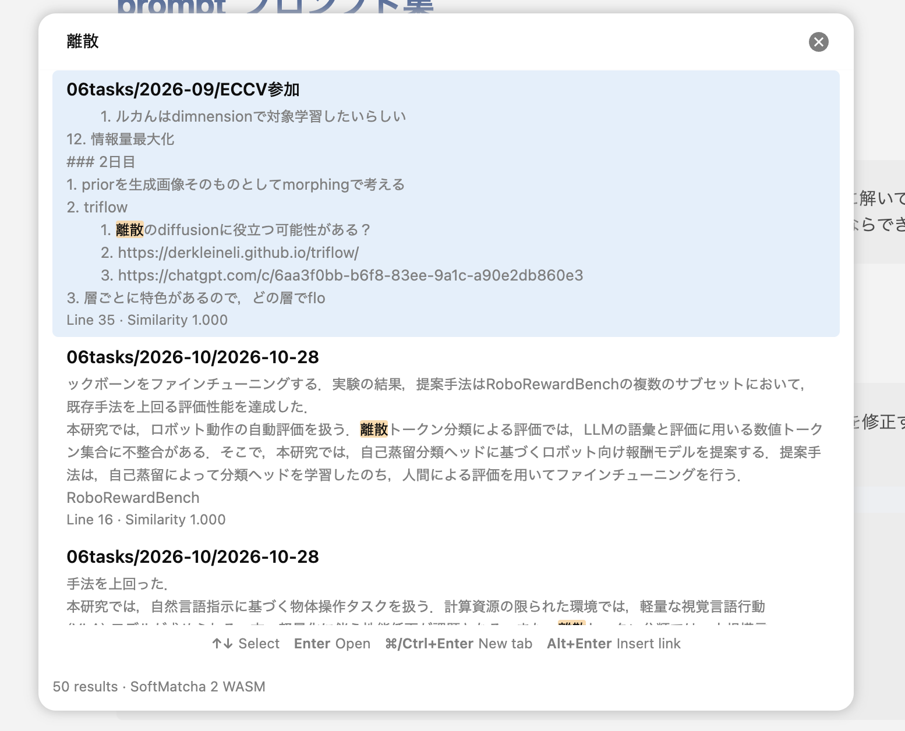
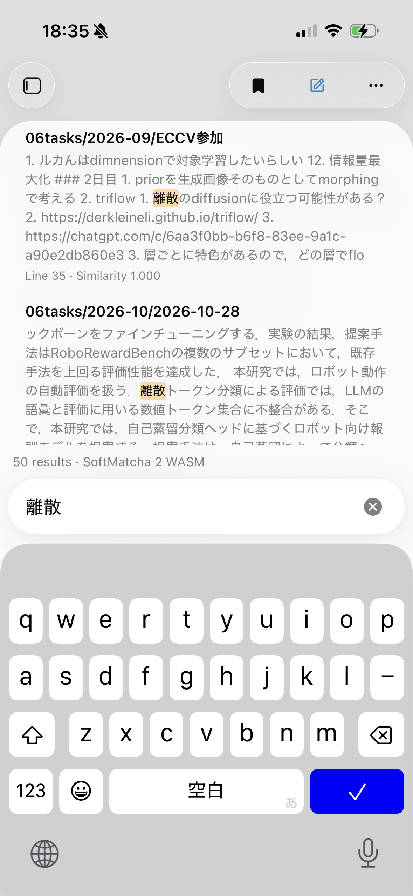

# SoftMatcha Search

**Find the passage—even when you forget the exact words.**

Fast, powerful **local vector search** for Obsidian. **English & Japanese · Desktop & mobile · No API key or server.**

Powered by [SoftMatcha 2](https://arxiv.org/abs/2602.10908): match similar words and phrase variations, highlight the passage, and jump straight to it.

**[Install from Community Plugins](https://community.obsidian.md/plugins/softmatcha-search)**

<table>
  <tr>
    <td width="72%" valign="top"></td>
    <td width="28%" valign="top"></td>
  </tr>
</table>

## Find. Open. Keep writing.

- **Built for speed.** Rust + WebAssembly, with search running in a background worker.
- **Search beyond exact words.** Combine exact matching with similarity-based phrase search.
- **See the match.** Highlighted excerpts with direct navigation to the source line.
- **Stay in flow.** Open results in a new tab or insert a `[[link]]` from the keyboard.
- **Choose your footprint.** Enable English and Japanese models independently; exact search works without either.

Open **SoftMatcha Search: Search vault** from the command palette or tap the search ribbon icon. Set your shortcut in **Settings → Hotkeys**; try `Cmd/Ctrl + Shift + O`.

## Local vector search. Your notes stay yours.

Search runs on your device. Missing models for enabled languages download automatically from GitHub Releases in the background; opt out in settings. After setup, search works offline. **Notes and search queries are never uploaded.** [Privacy details](docs/PRIVACY.md)

## License

Original code and documentation: [MIT](LICENSE). SoftMatcha 2 port: Apache-2.0 with MIT portions. fastText models: CC BY-SA 3.0. Japanese dictionary: upstream terms. [Third-party notices](licenses/THIRD_PARTY_NOTICES.md) · [License texts](licenses/)
